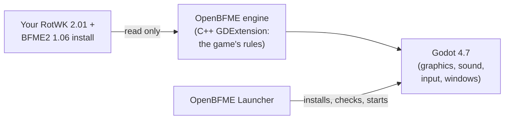

<div align="center">

# OpenBFME

**The Battle for Middle-earth II: The Rise of the Witch-king 2.01, rebuilt in Godot.**

[](https://github.com/Open-BFME/openbfme-godot/releases)
[](LICENSE)
[](https://godotengine.org)
[](#play-it)

<a href="https://github.com/Open-BFME/openbfme-godot/releases"></a>

<sub>The newest alpha build is at the top of the releases page: one file per system, <code>openbfme-…-windows-x64.zip</code> or <code>openbfme-…-linux-x64.tar.gz</code>, with the game and the launcher in it.</sub>

[Play it](#play-it) · [Status](#status) · [Where it's going](#where-its-going) · [Build from source](#build-from-source) · [Player guide](docs/PLAYING.md) · [Roadmap](docs/ROADMAP.md)

</div>

## What it is

OpenBFME is built with AI assistance and is still being optimized. The Rise
of the Witch-king has not been decompiled yet, so many features are reverse
engineered from the game, and some use a stand-in until OpenBFME's RotWK
decompilation project is complete.

OpenBFME is a faithful, fan-made recreation of **The Rise of the Witch-king
2.01** that runs on the original game files from your own install. This
repository contains no game assets: you bring your own copy of the game, or
let the launcher download it (see [Play it](#play-it)).

The game logic is C++ in a GDExtension (`engine/`). It is translated from
EA's Command & Conquer Generals: Zero Hour source and the BFME decompiles,
and checked against the RotWK program itself, keeping the original SAGE class
and file names. Godot 4.7 (`godot/`) does the drawing, sound, input and
windows. The previous codebase lives on in this repository's history (tag `legacy-final`).



OpenBFME is unofficial. It is not made or endorsed by EA.

## Play it

> **Alpha builds.** These are early alpha builds for testers. Expect missing
> features and rough edges; see [Status](#status) and the known issues in the
> [player guide](docs/PLAYING.md#known-issues). Releases have plain numbers:
> Alpha 0.4.5, then 0.4.6 and so on, and the middle number goes up (0.5.0) when
> a big new feature lands. Your launcher updates to each one by itself.

**You need** **The Rise of the Witch-king 2.01** and **The Battle for
Middle-earth II 1.06**, both in English, and Windows 10/11 or 64-bit Linux
with Vulkan graphics (or Direct3D 12 on Windows).

1. **Download OpenBFME** from
   [GitHub Releases](https://github.com/Open-BFME/openbfme-godot/releases):
   `openbfme-<version>-windows-x64.zip` or
   `openbfme-<version>-linux-x64.tar.gz`. It is one file with the game and the
   launcher in it. Unpack it into a folder you can write to.
2. **Start the game or the launcher**: `OpenBFME.exe` or
   `OpenBFMELauncher.exe` (on Linux `./OpenBFME.x86_64` or
   `./OpenBFMELauncher.x86_64`). The game is ready to play, with no first
   download, and whichever one you start keeps OpenBFME up to date: a newer
   build is downloaded in the background, checked against the signed release,
   and used from your next start. On Windows, SmartScreen may say
   *Windows protected your PC*, because the files are not code-signed yet:
   choose *More info*, then *Run anyway*.
3. **Play.** On the first start the game looks for your RotWK and BFME2
   folders (the registry entries the original installers write, and on Linux
   also Wine, Proton, Lutris, Heroic and Bottles prefixes). Confirm them or
   choose them with *Browse...*. It checks every game file once (this can
   take a minute) and remembers the folders.

**No games installed?** The launcher shows *Download the games*: files from the
All In One BFME Launcher service (BFME Foundation, Patch 2.22 team), about
8.6 GB, every file checked.

**Logs.** Every run writes a session log, with your user name and home folder
removed:

| | Log folder |
|---|---|
| Windows | `%APPDATA%\Godot\app_userdata\OpenBFME\logs\` |
| Linux | `~/.local/share/godot/app_userdata/OpenBFME/logs/` |

You never have to find it by hand: click **Logs** next to the version number
in the menus, or **Open log folder** in any error or crash message. After a
crash, the next start tells you which log to send.

**Free camera.** The launcher's *Free camera* setting (Settings > General) lets
the camera zoom out to the whole map. This is an OpenBFME option,
not part of the original game; in a game, Ctrl+Z switches it on and off. From
the command line it is `-- --free-camera`.

Everything else (updates, hotkeys, troubleshooting) is in the
**[player guide](docs/PLAYING.md)**.

## Status

What works today, in plain terms. "Partial" means you can use it but parts of
the original are still missing.

| Area | Status | Notes |
|---|---|---|
| Finding and checking your game files | ✅ Works | English 2.01 / 1.06 installs; other languages are refused for now |
| Skirmish, all 7 factions | ✅ Works | Men, Elves, Dwarves, Isengard, Mordor, Goblins and Angmar; scripted test players played 71 games through the real menus and controls in the latest full sweep, every faction, with no crash or stall |
| Combat, hordes, heroes, spell book | ✅ Works | horde formations, cavalry charges, sieges, powers; details are still being matched to the original |
| Team colours | 🟡 Partial | units and buildings show their player's colour, but how the colour is blended in is an educated guess, not yet checked against the original |
| Building, economy, upgrades | ✅ Works | builders, walls, castles, resources, upgrades and experience |
| Computer opponent | 🟡 Partial | builds a base, trains armies and heroes, uses its spell book and most of its powers, attacks and finishes games; defending and expanding are not yet like the original |
| In-game interface | ✅ Works | Palantir, command bar, RotWK's radar and pings, health bars and levels, control groups, camera bookmarks, hotkeys, right-click orders as in the original |
| Main menu and options | 🟡 Partial | real menus with the original layout; the credits roll; the graphics detail level sets particles, texture quality and health bars, but shadows and the other detail rows are not drawn yet; OpenBFME's own settings inside Options |
| Sound and music | 🟡 Partial | voices, effects, music and the original stereo image; some sounds (damage sounds, scripted music, parts of the big-battle ambience) are missing |
| Movies | ✅ Works | the start-up logos and intro, and the campaign movies (no subtitles) |
| Campaign | 🟡 Partial | missions start from the menu with their movies and narration; missions can be saved and loaded, but the original game's campaign-progress saving and the campaign menu between missions are not done yet |
| LAN multiplayer | ✅ Works | Windows and Linux players in one game, disconnect screen, every game recorded |
| Replays | 🟡 Partial | every game is recorded and can be watched from *Load Replay*; no saving under a name, no replay controls |
| Create-a-Hero | ✅ Works | the hero builder, colours and saving; heroes can be fielded in skirmish and LAN |
| Save / load | 🟡 Partial | skirmish and campaign missions save and load through the original Save / Load screens (OpenBFME's own save files, not the original game's) |
| War of the Ring | ❌ Not yet | |
| Online multiplayer | 🟡 Test feature | server browser, rejoin and spectating on the original online screens, through an OpenBFME lobby and relay; there is no public lobby yet, so someone has to host one ([player guide](docs/PLAYING.md#online-play-test-feature)) |
| Mods | ❌ Not yet | designed in from the start; Edain is the first target |

**Faithful first.** OpenBFME copies the original game's behaviour; it does
not reinvent it. Where the evidence runs out and the team has to make an
educated guess, that guess is not hidden: it is recorded as an *acceptance
stop* in [docs/STOPS.md](docs/STOPS.md), reported by the game at runtime and
pinned by a test. There are **784 open stops** today. Some are big
(retail save files), most are small details waiting for better evidence. The plan to
get to a 1:1 game is in [docs/ROADMAP.md](docs/ROADMAP.md).

**Latest version.** The newest build and its patch notes are on the
[releases page](https://github.com/Open-BFME/openbfme-godot/releases); the
history is in [docs/CHANGELOG.md](docs/CHANGELOG.md).

## Where it's going

1. Skirmish and multiplayer parity with the original: every faction, the
   computer opponent, LAN and online games, replays.
2. The Rise of the Witch-king campaign.
3. The Battle for Middle-earth II Good and Evil campaigns.
4. War of the Ring.
5. Mods, with Edain first.

The full plan, with what is done and what is next, is in
[docs/ROADMAP.md](docs/ROADMAP.md).

## Build from source

You need Git, CMake (3.17 or newer), Ninja, a C++17 compiler and
[Godot 4.7](https://godotengine.org/download). Clone with the `godot-cpp`
submodule:

```sh
git clone --recursive https://github.com/Open-BFME/openbfme-godot
cd openbfme-godot
```

**Linux** (GCC or Clang):

```sh
cmake -S engine -B engine/build -G Ninja -DCMAKE_BUILD_TYPE=Release
cmake --build engine/build --target openbfme openbfme_tests   # extension -> godot/bin/
export ROTWK_INSTALL=/path/to/RotWK BFME2_INSTALL=/path/to/BFME2
engine/build/openbfme_tests                                   # unit tests (retail tests skip without the two folders)
godot --path godot                                            # start the game
```

**Windows** (Visual Studio 2022 with the C++ x64 tools, CMake, Ninja):

```bat
build.bat
set ROTWK_INSTALL=<RotWK folder>
set BFME2_INSTALL=<BFME2 folder>
set GODOT=<path to the Godot 4.7 console exe>
run_tests.bat
%GODOT% --path godot
```

`build.bat` writes the extension to `godot\bin` and the tests to
`engine\build`. `run_tests.bat` exits 0 when everything passed and 77 when
the install folders are not set (the game tests are skipped). Windows builds
can also be cross-compiled from Linux with `tools/release/build_windows.sh`;
see [docs/WINDOWS.md](docs/WINDOWS.md). Packaging and releases are described
in [docs/RELEASE.md](docs/RELEASE.md).

MP3 decoder tests use the reference-machine fixtures (LAME 3.100, matching
`engine/tests/data/audio/mp3_golden.tsv`). On other platforms, including macOS,
configure with `-DOPENBFME_LAME=OFF` and set `OPENBFME_AUDIO_FIXTURES` to the
directory containing the unpacked reference fixtures before running the tests.
`OFF` disables regeneration, not the tests; keep the fixture bytes outside git.

Instead of the environment variables, the install folders can live in
`user://install-paths.cfg` as `KEY=VALUE` lines (the game's first-run screen
writes this file). Mounting checks every archive's size and MD5 against
`engine/data/retail-archives/` and stops on any unknown or changed file. The
load order is documented in `engine/src/Common/RetailArchivePolicy.h`.

## How it's made

The work is split into lanes, each porting one system from the RotWK 2.01
program, the Open-BFME decompiles and the Zero Hour source, citing the exact
address or file it comes from. Every change is reviewed before it is merged,
and gates run the real retail data: the unit tests, scripted skirmish and LAN
games, replays that must match frame by frame, and Windows-vs-Linux lockstep
games that must stay in sync. The standing rules are in
[docs/PLAN.md](docs/PLAN.md).

## Devlogs

Video devlogs on the [OpenBFME YouTube channel](https://www.youtube.com/@OpenBFMEGodot):

- [Devblog #1](https://www.youtube.com/watch?v=dPUWMVaxbSM)
- [Devblog #2](https://www.youtube.com/watch?v=tynar_O2_ps)
- [Devlog #3: You Asked, We Fixed](https://www.youtube.com/watch?v=15T9RJKba9g)

## Feedback and bug reports

- **Bugs:** open an issue on
  [GitHub](https://github.com/Open-BFME/openbfme-godot/issues), or post in
  the OpenBFME Discord's `#feedback` channel (join from the YouTube channel
  page).
- **Always attach the session log** of the run where it happened (see
  [Logs](#play-it)), and say which version you played (it is shown in the top
  right corner of the menus) and what you did. On Windows, send the log file,
  not a copy of the console window.
- Community reports and their state are tracked in the
  [roadmap](docs/ROADMAP.md#community-feedback-intake-fb-items-updated-2026-10-10).
- **Pull requests** are welcome: [CONTRIBUTING.md](CONTRIBUTING.md) says how
  they are checked, reviewed and merged with the next release (and that game
  files never go into the repository).

## Behaviour references

- RotWK 2.01 INI files: every number in the game.
- EA's Command & Conquer Generals: Zero Hour source (GPL-3): the SAGE
  engine that BFME was built on.
- [Open-BFME-1](https://github.com/Open-BFME/Open-BFME-1) and
  [Open-BFME-2](https://github.com/Open-BFME/Open-BFME-2): matching
  decompilations of BFME1 and BFME2.

## Licence

GPL-3.0; see `LICENSE` and `NOTICE` (Zero Hour-derived parts and EA's terms).
